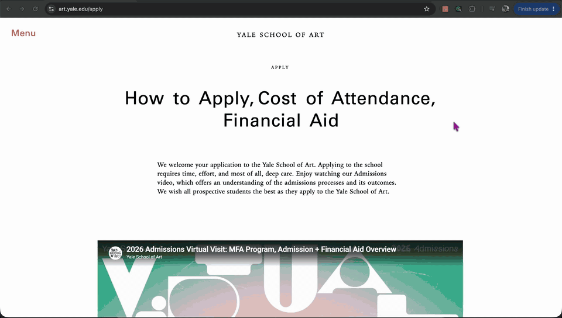
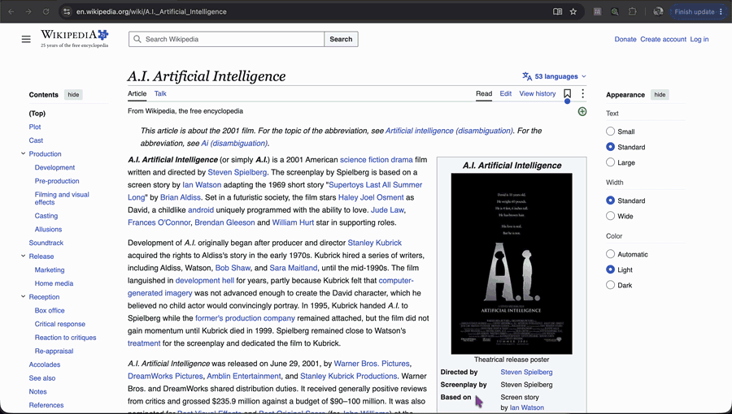

# Div Inspector

A Chrome extension for inspecting elements without a giant tooltip following your cursor around.

- The icon shows a blue **ON** badge while the inspector is running on that tab.
- A small toast in the top-right lists the keys. Close it with **×**.
- Hover any element to get a dashed blue outline, plus margin (orange) and padding (green) overlays.
- If the element (or its parent) is a CSS grid, its cells show as purple dashed boxes and the label shows the grid size (e.g. `grid 3×2`).
- A small label shows the tag, classes, size, and the React/Vue component name.
- Press **S** for a docked details panel: box model, spacing, size, font, colors, border, layout, effects.
- Drag the panel by its dark header to move it out of the way. It stays put until you double-click the header to re-dock it.
- Click **—** in the header to minimize the panel to just its header. Click **▢** to expand it. **A** expands it too.
- Press **S** again to hide it.
- Press **C** to copy the hovered element for AI: selector, component chain, size, parent layout, non-default computed styles, and an HTML snippet as Markdown. Paste it into Claude/ChatGPT and ask for a fix.
- Press **Esc** to turn the inspector off.

## Install

1. Clone this repo.
2. Open `chrome://extensions` and turn on **Developer mode** (top-right).
3. Click **Load unpacked** and pick this folder.
4. Pin the icon.

## Use

| Action | What it does |
| --- | --- |
| Click icon / `Alt+Shift+D` | Toggle on/off |
| Hover | Highlight element |
| `S` | Show/hide details for the hovered element (locks it) |
| `A` | Ask a local AI (Ollama) about the hovered element, then live-preview its CSS fixes |
| `C` | Copy the hovered element as an AI-ready prompt |
| `Esc` | Turn off |

## Ask AI (Ollama, free + local)

Press **A** on an element (or use the box at the top of the **S** panel) to ask a question about it. Answers stream in from [Ollama](https://ollama.com) on your machine. Nothing leaves your computer.

1. Install Ollama and run `ollama serve`.
2. Pull a model: `ollama pull qwen2.5-coder:7b` (the default). Any installed model works. Pick it from the dropdown.
3. If you get a 403, restart with `OLLAMA_ORIGINS="chrome-extension://*" ollama serve`.

### Preview suggestions live

- When an answer finishes, every CSS code block gets a **▶ Preview** button.
- Click it to apply that CSS to the page right away. Click **↺ Revert** to undo.
- Rules land on whatever their selector matches (the element, a parent, or its children). Bare declarations go on the inspected element.
- Previews revert when you close the panel, ask a new question, or press **Esc**.
- CSS only. HTML suggestions can't be previewed.

## Notes

- Component names show up best on dev builds. Production builds usually minify them.
- Chrome blocks extensions on `chrome://` pages and the Web Store.
